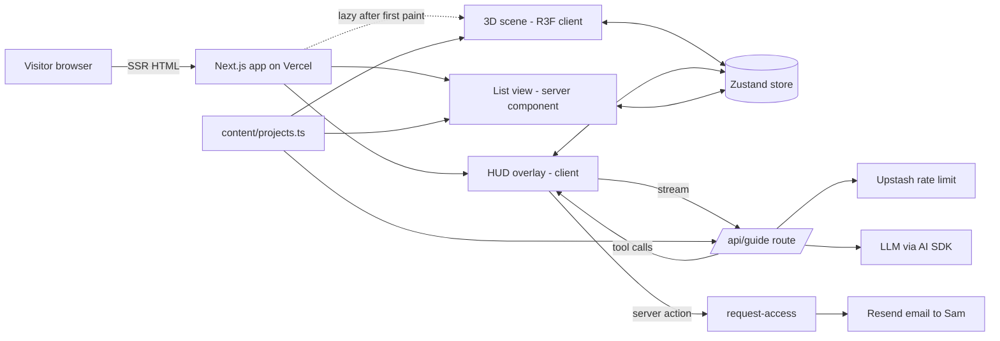
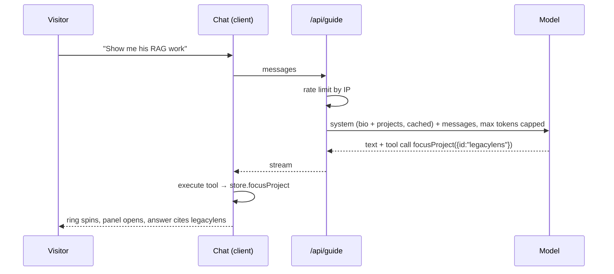

# Architecture

## System


## Data
- `content/projects.ts` exports `projects: Project[]`, validated by `lib/schema.ts` at build time (a Vitest test fails the build on bad data).
- Assets in `public/projects/<id>/` (poster.webp, screenshots, optional demo.mp4 hosted externally if large).

## State (store/ui.ts)
```ts
activeProjectId: ProjectId | null   // the selection: the detail panel shows it
frontProjectId: ProjectId | null    // the panel at the front of the ring
filters: { skills: string[]; tags: string[] }
viewMode: 'ring' | 'list'
ringReady: boolean                  // the 3D scene has loaded
tier: 'high' | 'medium' | 'low'     // effects tier, from measured frame rate
coreActivity: number                // 0–1, read by the render loop; the guide drives it
actions: focusProject(id), setFrontProject(id), setFilters(f), clearFilters(),
         setViewMode(m), setRingReady(b), setTier(t), setCoreActivity(n)
```
Clicks, keyboard, and AI tool calls all call these same actions. `focusProject` also sets the front project, so the ring follows every selection.

## 3D scene
- `components/hud/RingStage.tsx` — the only ring code in the first load. After first paint, when the browser is idle and WebGL exists, it imports the scene with `next/dynamic({ ssr: false })`. `?view=list` skips it.
- `RingScene.tsx` — root of the lazy chunk: the stage (focusable, labelled), keyboard / drag / swipe / wheel handlers, the DOM labels, the controls and the live region. Mounting it switches to ring view; the list is hidden by CSS and stays in the DOM.
- `Renderer.tsx` — Canvas setup (WebGL, transparent, pixel ratio per tier up to [1, 2], PerformanceMonitor → `tier`). Only file that knows the renderer.
- `Ring.tsx` — positions 8 `ProjectPanel`s on a circle; rotation damped toward the front project in `useFrame`.
- `ProjectPanel.tsx` — one glass pane; eases scale, lift, opacity and edge glow on refs, and writes a CSS matrix onto its DOM label each frame.
- `Core.tsx`, `Platform.tsx`, `Lighting.tsx` — the sphere and halo, the disc (reflective on the high tier), lights and a code-built environment.
- `CameraRig.tsx` — fits the ring to the stage and slides when a project is selected, in `useFrame`.
- `Effects.tsx` — bloom plus the alpha fix for a transparent canvas; off on the low tier.
- `actions.ts` — turns ring actions and keys into store calls. `lib/ring.ts` — the pure math (angles, shortest turn, drag snap, key map).
- Per-frame values (drag offset, current rotation, label nodes) live in a plain mutable object, `input.ts`, never in React state.

## AI guide flow

Tools run client-side (they change UI only). The server never navigates or fetches on the model's behalf.

## Request code access
Server action validates with Zod, checks honeypot + rate limit, sends email via Resend. No API keys or Sam's email in the client.

## Performance budget
| Metric | Target |
|---|---|
| LCP | < 2.5s (list view renders first) |
| JS before 3D | < 150 KB gzipped |
| 3D chunk | loaded after first paint |
| FPS | 60 desktop; low tier stays smooth on mid phones |
