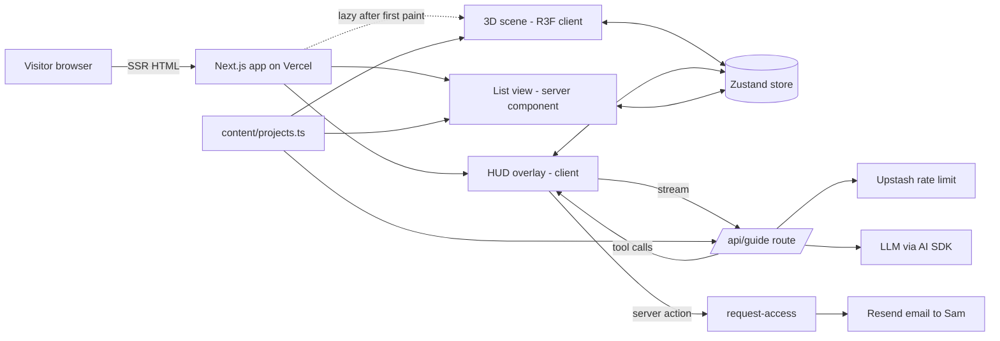
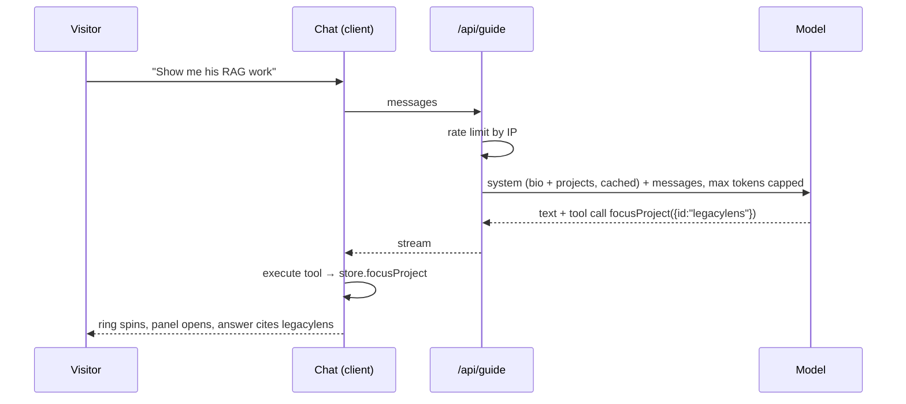

# Architecture

## System


## Data
- `content/projects.ts` exports `projects: Project[]`, validated by `lib/schema.ts` at build time (a Vitest test fails the build on bad data).
- Assets in `public/projects/<id>/` (poster.webp, screenshots, optional demo.mp4 hosted externally if large).

## State (store/ui.ts)
```ts
activeProjectId: string | null
filters: { skills: string[]; tags: string[] }
viewMode: 'ring' | 'list'
actions: focusProject(id), setFilters(f), clearFilters(), setViewMode(m)
```
Clicks, keyboard, and AI tool calls all call these same actions.

## 3D scene
- `Renderer.tsx` — Canvas setup (WebGL, dpr clamp [1, 2], PerformanceMonitor). Only file that knows the renderer.
- `Ring.tsx` — positions 8 `ProjectPanel`s on a circle; rotation target from store; damped toward target in `useFrame`.
- `CameraRig.tsx` — eases camera to active panel in `useFrame`.
- `Effects.tsx` — bloom etc., disabled on low tier.
- Loaded via `next/dynamic({ ssr: false })` after first paint.

## AI guide flow

Tools run client-side (they change UI only). The server never navigates or fetches on the model's behalf.

## Request code access
Server action validates with Zod, checks honeypot + rate limit, sends email via Resend. No API keys or Sam's email in the client.

## Performance budget
| Metric | Target |
|---|---|
| LCP | < 2.5s (list view renders first) |
| JS before 3D | < 150 KB gzipped |
| 3D chunk | loaded after first paint |
| FPS | 60 desktop; low tier stays smooth on mid phones |
